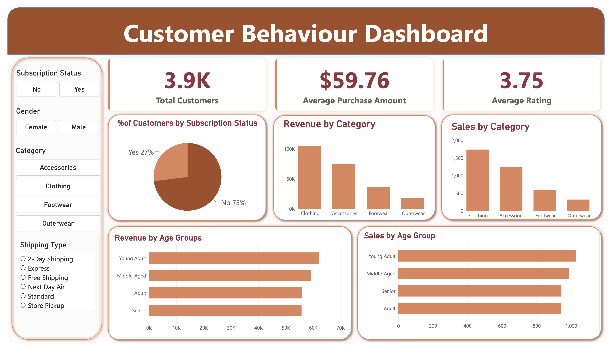

# Customer Behavior Data Analysis

An end-to-end data analytics project analyzing customer shopping behavior to identify purchasing patterns, customer segments, and sales drivers.

## Project Overview

This project follows a complete **Python → SQL → Power BI** workflow, from data cleaning and exploratory analysis to business insights and visualization.

### Python — Data Cleaning & EDA

- Data cleaning and transformation
- Missing value handling
- Exploratory Data Analysis
- Data preparation for SQL

**Libraries:** Pandas, NumPy, Matplotlib

### SQL — Data Analysis

- Customer segmentation
- Purchasing behavior analysis
- Sales and product analysis
- Business-focused SQL queries

### Power BI — Dashboard

An interactive dashboard covering:

- Customer demographics
- Sales performance
- Purchase behavior
- Product categories
- Customer segments
- Key KPIs

## Skills & Tools

**Python | Pandas | NumPy | Matplotlib | SQL | Power BI | Power Query | DAX**

## Project Files

| File | Description |
|---|---|
| `analysis.ipynb` | Python cleaning and EDA |
| `customer_behavior.sql` | SQL analysis |
| `Customer_Behavior_Analysis.pbix` | Power BI dashboard |

## How to Use

1. Open the Python notebook to review the data preparation and EDA.
2. Review the SQL file for the business analysis.
3. Open the `.pbix` file in **Power BI Desktop** to explore the dashboard.

## Dataset

The dataset contains customer demographics, purchasing behavior, product categories, discounts, shipping preferences, and other shopping-related information.

## Outcome

The project demonstrates an end-to-end approach to transforming raw customer data into **analysis, business insights, and an interactive dashboard** using Python, SQL, and Power BI.
